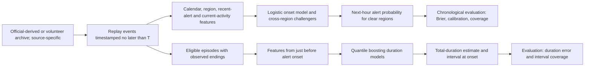
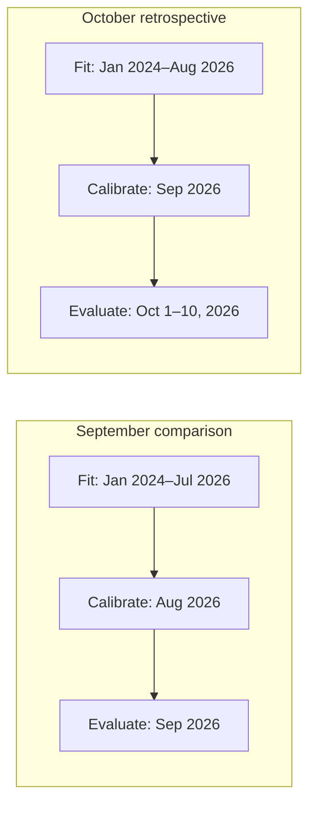

# KSE Stage 2: Ukraine Air-Alert Time-Series Forecasting

Research code for regional air-alert history, one-hour alert-onset probability,
and alert-duration-at-onset estimates. This is a retrospective research prototype,
**not an operational warning system**. Always follow official alerts and guidance.
The model currently forecasts *any* alert in a reconstructed clear region; it
does not provide validated missile- or UAV-specific probabilities.

## Key engineering lesson

> During review, I found that an early duration-model implementation selected
> historical episodes using their start time but did not require the episode
> to have ended before the fitting cutoff. This allowed future duration
> information into some training labels. I corrected the split to require
> `end_epoch < fit_cutoff` and added regression tests to prevent recurrence.

## Results at a glance

| Forecast | Evaluation window | Scored cases | Model | Simple baseline | Error measure |
|---|---|---:|---:|---:|---|
| Alert starts in next hour | Sep 2026 | 12,699 clear region-hours | 0.15543 | 0.16707 | Brier score |
| Alert starts in next hour | Oct 1–10, 2026 | 3,787 clear region-hours | 0.16818 | 0.18018 | Brier score |
| Total duration at alert onset | Oct 1–10, 2026 | 1,323 eligible completed episodes | 18.8 min | 19.5 min | Mean absolute error |

Lower is better in every row. Onset uses calibrated logistic regression versus
a calibrated region/hour frequency baseline. Duration uses quantile boosting
versus a training-period regional median. September had already been inspected;
October is a retrospective archive replay, not a pristine unseen holdout.
Duration scoring excludes open and uncertain episodes. These results do not
establish operational reliability or missile/UAV-specific prediction.
The detailed figures are generated locally in `reports/learning_v2/metrics.json`
and `reports/october_2026_review/metrics.json` by the commands below.

## Workflow at a glance



Telegram posts support candidate threat annotations and descriptive analysis;
they are **not** inputs to these forecast models. For the onset comparisons,
the outcome window must finish before any fitting cutoff:



## Installation and quick start

Use Python 3.12 and the pinned dependencies:

```bash
python3.12 -m venv .venv
.venv/bin/python -m pip install -r requirements.txt
```

The repository intentionally omits raw archives, derived datasets, saved models,
and generated reports. Obtain the source snapshots described below before running
data preparation or training. To reproduce the exact historical
numbers, the same source snapshot versions are needed; upstream files and edited
Telegram posts can change after collection.

For a download-free smoke test, `tests/fixtures/synthetic_alerts.csv` contains
240 wholly synthetic example rows dated in 2030, including open and estimated
ends. Run `.venv/bin/python -m unittest discover -s tests -v` without the large
raw CSV or Telegram archives; the full-archive integration check is skipped
when those files are absent. The fixture is for tests only, not model training
or evaluation.

### Local historical forecast dashboard

The optional Streamlit dashboard presents a single region's next-hour onset
probability, a regional comparison table, a color-coded map and review details.
It uses the **existing saved baseline models and prediction command**; it does
not change training or make a live forecast. Install the extra UI dependency
after the core requirements, and download the pinned map boundaries once:

```bash
.venv/bin/python -m pip install -r requirements-ui.txt
.venv/bin/python scripts/prepare_dashboard_map.py
.venv/bin/python -m streamlit run dashboard.py --server.address 127.0.0.1
```

Open the local address printed by Streamlit. The dashboard requires the raw
archive snapshots in `data/raw/` and locally generated baseline models in
`models/learning_baseline/`; both are intentionally excluded from Git. Select
an archive and a historical UTC hour within its coverage. The prediction
command checks the saved model's fit cutoff, validity interval, hourly cadence,
full forecast horizon and source-snapshot hash. If any check fails, the display
shows an error instead of a probability. `data/geo/` is also ignored; its
administrative map is a 2017 [geoBoundaries gbOpen UKR ADM1](https://www.geoboundaries.org/api/current/gbOpen/UKR/ADM1/)
snapshot under ODbL 1.0, **not** a current front-line map.

The display clearly separates numeric forecasts from abstentions for active or
unresolved regions. It cannot provide validated missile/UAV-specific odds or
predict when an active alert will end. Only load saved models you generated or
trust locally: joblib model files can execute code when loaded.

## Data sources and preparation

- The [Ukrainian Air Raid Sirens Dataset](https://github.com/Vadimkin/ukrainian-air-raid-sirens-dataset)
  supplies the `official_data_en.csv` and `volunteer_data_en.csv` archives. The
  first is *official-derived*, not a direct official API feed. Their coverage and
  alert definitions differ; the official-derived snapshot used here ends on
  7 September 2026.
- Public posts from the [@kpszsu Telegram channel](https://t.me/kpszsu) provide
  candidate threat descriptions for January–September 2026. Posts may be edited,
  and a time/region overlap does not prove that a post caused a given alert.
  No corresponding 2024–25 threat archive was collected.

Place the two CSV archives at `data/raw/official_data_en.csv` and
`data/raw/volunteer_data_en.csv`. The public-channel collector can create
`data/raw/kpszsu_2026-01-01_2026-09-30.jsonl`:

```bash
mkdir -p data/raw
curl -fL https://raw.githubusercontent.com/Vadimkin/ukrainian-air-raid-sirens-dataset/main/datasets/official_data_en.csv \
  -o data/raw/official_data_en.csv
curl -fL https://raw.githubusercontent.com/Vadimkin/ukrainian-air-raid-sirens-dataset/main/datasets/volunteer_data_en.csv \
  -o data/raw/volunteer_data_en.csv
.venv/bin/python scripts/collect_telegram_public.py \
  --output data/raw/kpszsu_2026-01-01_2026-09-30.jsonl \
  --checkpoint data/raw/kpszsu_2026-01-01_2026-09-30.checkpoint.json
.venv/bin/python scripts/prepare_historical_window.py
.venv/bin/python scripts/prepare_historical_window.py \
  --start 2024-01-01 --end-exclusive 2026-01-01
.venv/bin/python scripts/normalize_and_reconcile.py
.venv/bin/python scripts/normalize_and_reconcile.py \
  --start 2024-01-01 --end-exclusive 2026-01-01
.venv/bin/python -m unittest discover -s tests -v
```

Review upstream provenance, licensing, and current coverage before redistributing
source data. The files are excluded from Git to avoid publishing a large,
potentially changed archive as though it were the verified research snapshot.
The optional `.mjs` workbook builders require Node.js and `@oai/artifact-tool`
from the original Codex workspace; they are not needed for the Python models.

## Forecasting and evaluation in brief

Each hourly forecast asks whether a currently clear region becomes active in the
next 60 minutes. Baseline regularized logistic regression uses region, Kyiv-local
calendar, recent own-region onset history, time since onset, and current national
alert activity. Challengers add cross-region features or histogram gradient
boosting. Separate quantile boosting models estimate *total* alert duration at
onset, not remaining duration during an ongoing alert.

Evaluation uses chronological splits and a full one-hour label embargo before
each fit. It reports Brier score, log loss, ranking, calibration, coverage, and
duration error against simple frequency/region-median baselines. Features are
constructed only from events timestamped no later than the forecast origin;
future outcomes are excluded from training. Historical reception times and edit
histories are unavailable, so timestamp-causal replay is **not** proof of true
point-in-time availability. The October 1–10, 2026 volunteer-only comparison is
retrospective and was not a pristine unseen holdout.

See the sections below for exact run commands, evaluation windows, audit findings,
and limitations.

Normalized alert windows: **2024-01-01 through 2025-12-31** and
**2026-01-01 through 2026-09-30**, both using UTC date boundaries.

## Data layout

- `data/raw/`: immutable downloaded source snapshots.
- `data/interim/`: exact-period subsets; records are not deduplicated or otherwise corrected.
- `data/processed/`: normalized and reconciled alert episodes.
- `reports/`: machine-readable audit results.
- `scripts/prepare_historical_window.py`: reproducible filtering and first-pass audit.
- `scripts/normalize_and_reconcile.py`: deduplicates, normalizes and merges alert
  intervals, reconciles sources, classifies KPSZSU posts and creates candidate
  threat-to-alert links.

The `*_starts_*` files contain alerts whose start timestamp falls inside the
window. The `*_overlap_*` files additionally retain alerts that began before the
window but were still active during it.

Run:

```bash
python3 scripts/prepare_historical_window.py
python3 scripts/prepare_historical_window.py --start 2024-01-01 --end-exclusive 2026-01-01
```

Raw source values are preserved. Estimated volunteer endings (`naive=True`) are
not considered observed duration labels in subsequent modelling.

## Acquired snapshots

- `data/raw/official_data_en.csv`: complete downloaded source snapshot; its
  latest alert starts on 2026-09-07, so it does not cover the full requested
  September period.
- `data/raw/volunteer_data_en.csv`: complete downloaded source snapshot; the
  requested nine-month subset has full calendar coverage.
- `data/raw/kpszsu_2026-01-01_2026-09-30.jsonl`: public `@kpszsu` posts for the
  exact requested UTC window, including post IDs, timestamps, current text,
  reply links, edit flags, and source URLs.

The files in `data/interim/` are date-window subsets only. They intentionally
retain source duplicates and imputed endings. Do not use them directly as model
labels before reconciliation.

Audit outputs:

- `reports/historical_data_audit_2026-01-01_2026-09-30.json`
- `reports/kpszsu_audit_2026-01-01_2026-09-30.json`
- `reports/normalization_report_2026-01-01_2026-09-30.json`
- `reports/historical_data_audit_2024-01-01_2025-12-31.json`
- `reports/normalization_report_2024-01-01_2025-12-31.json`

Run normalization:

```bash
python3 scripts/normalize_and_reconcile.py
python3 scripts/normalize_and_reconcile.py --start 2024-01-01 --end-exclusive 2026-01-01
```

The default 2026 outputs remain in `data/processed/`. The 2024–2025 outputs are
in `data/processed/2024-01-01_2025-12-31/`; no Telegram archive was collected
for those earlier years. An oblast episode means at least one contributing
locality was under alert, not necessarily the entire oblast. Long unions,
estimated volunteer ends, ambiguous official one-hour ends, and window-clipped
episodes are flagged or excluded from duration targets pending review.
Rule-based threat labels, event clusters and alert links are candidate
annotations and should be checked before they are used as model labels.
- `reports/acquisition_summary_2026-01-01_2026-09-30.md`
- `reports/normalization_summary_2026-01-01_2026-09-30.md`
- `reports/normalization_summary_2024-01-01_2025-12-31.md`

## First learning model

The Python baseline answers: **if a region is reconstructed as clear now, what
is the probability that it becomes active within the next 60 minutes?** It runs
on hourly UTC origins with Kyiv-local calendar features. A region means any
mapped locality becoming active; it does not imply an oblast-wide declaration.
Already-active or unresolved regions receive no onset probability. There are
24 supported region IDs (23 oblasts plus Kyiv City); this is not all Ukraine.

The model is regularized logistic regression:

`p = 1 / (1 + exp(-(intercept + coefficients · standardized_features)))`

Features are fixed region indicators, local calendar cycles, past onset counts,
time since the last regional onset and the fraction of regions currently active.
The scaler and model are fitted on matured training examples only. The output
is a probability estimate, not an assurance that an alert will or will not occur.

Default evaluation:

- Initial training: 1 January 2024–31 December 2025, with a horizon embargo.
- January–July 2026: expanding history, refit every five days. Five days is an
  evaluation block, **not** the entire training history.
- From 1 August 2026: one frozen holdout model, without later outcome updates.
- Official-derived history: evaluation through 6 September. Volunteer history:
  through 30 September. Source-specific models are not directly comparable over
  their unequal periods; they are separate sensitivity checks.
- Compare with training-only regional and region/hour historical frequency
  baselines. Report Brier score, log loss, ranking, calibration and coverage.

Run with Python 3.12:

```bash
python3 -m venv .venv
.venv/bin/python -m pip install -r requirements.txt
.venv/bin/python -m unittest discover -s tests -v
.venv/bin/python scripts/train_alert_model.py
.venv/bin/python scripts/audit_alert_backtest.py
.venv/bin/python scripts/predict_alert.py \
  --model models/learning_baseline/volunteer/2026-08-01.joblib \
  --as-of 2026-08-03T12:00:00Z --region UA-30
```

Results: `reports/learning_baseline/summary.md`; each source folder includes
predictions, fold cutoffs, region/month metrics, calibration bins and forecast
coverage. Saved models are trusted local pickle/joblib artifacts: never load
an untrusted model file. Re-running training replaces this run's generated
outputs, but does not modify raw archives.

### Leakage controls and limitations

The forecasting pipeline independently deduplicates and replays raw source
events. It deliberately does **not** use the retrospectively reconciled episode
table, final durations, Telegram threat clusters or later cross-source matches
as inputs. It preserves starts but omits imputed volunteer endings and ambiguous
exactly-one-hour official endings. An unresolved state stays active until a
subsequent activation and observed matching end resolve that locality; the
resulting reduced forecast coverage is reported, not silently treated as clear.

All feature events must be timestamped at or before the forecast. Every training
label window must end strictly before the fit cutoff. Tests check future-record
invariance, exact horizon boundaries, overlapping activations and embargoes.
The prediction command rejects a future-trained model, a changed source snapshot,
an unsupported forecast time and a horizon beyond source coverage.

**Historical availability cannot be certified:** archives lack reception/revision
histories and reliable feed-uptime logs. Event timestamps proxy availability, and
missing events can create false negative labels. These tests establish code-level
causality under that assumption, not a guarantee of genuinely point-in-time data.
Source changes toward locality-level reporting also change what the target means.

This is an exploratory generic-alert baseline, not yet a missile/UAV classifier,
duration estimator, live service or user interface. The earlier archive lacks
reviewed threat labels. No deployment or safety decision should rely on this
model; official alerts and instructions remain authoritative. Next iterations
need source/coverage review, threat-label validation and a new untouched test
period if the current holdout is used to choose improvements.

### Cross-region alert associations

To reproduce the one-hour source-active/target-clear comparison:

```bash
.venv/bin/python scripts/explore_cross_region.py
```

The script writes directed-pair metrics for each source and time period to
`reports/cross_region_patterns/`. It compares target onset rates while another
region is active, with an inactive-source comparison adjusted for coarse season,
local time and concurrent alerts elsewhere. These are exploratory associations,
not causal effects or aircraft-route estimates.

For the complete year-by-year breakdown (2024, 2025, and January–September
2026), run:

```bash
.venv/bin/python scripts/explore_cross_region_by_year.py
node scripts/build_cross_region_by_year_workbook.mjs
```

The analysis writes all 552 ordered region pairs for each archive/year to
`reports/cross_region_by_year/analysis.json` and a concise coverage audit to
`reports/cross_region_by_year/summary.md`. The filterable workbook is
`outputs/cross-region-by-year/ukraine_alert_directions_2024_2026.xlsx`; it has
separate year and by-region sheets. The official-derived archive stops before
September 7, 2026, while the volunteer archive extends through September 30.
No outcome after the stated period is included.

### Cross-region onset challenger and duration-at-onset

Run the next model comparison with:

```bash
.venv/bin/python scripts/train_alert_model_v2.py
```

The script compares the current-feature logistic model with a logistic model
including other-region active/recent-onset indicators and a histogram gradient
boosting classifier. Probabilities are Platt-calibrated on August 2026 and
compared on volunteer records from September 1–30. This September period was
inspected in earlier work, so the comparison is exploratory rather than a fresh
holdout. The official-derived archive ends September 7 and cannot provide a
complete parallel September evaluation. The script excludes every event after
September 30 and omits the final hourly forecast origin whose outcome would
extend into October.

Separate source-specific quantile gradient-boosting regressors estimate total
alert duration at the time of onset. They train on eligible complete 2024
episodes, calibrate interval width on 2025, then evaluate eligible complete
January–July 2026 episodes. Imputed, ambiguous, censored, clipped and >7-day
episodes are excluded. The output intervals are empirical and must not be
treated as operationally calibrated unless they continue to cover on new data.

Artifacts are saved under `models/` and `reports/learning_v2/`. Detailed results,
leakage checks and limitations are in `reports/learning_v2/summary.md` and
`metrics.json`. `--duration-only` refits only the duration models.

### October 1–10, 2026 retrospective comparison

The separately authorized October comparison is reproduced with:

```bash
.venv/bin/python scripts/evaluate_october_2026.py
.venv/bin/python scripts/audit_october_evaluation.py
```

Results are in `reports/october_2026_review/summary.md`, with complete regional,
daily, calibration and prediction records alongside it. Refreshed models are in
`models/october_2026_review/`. This run preserves the earlier trained models and
reports. The pre-October event digest must match the earlier September experiment.

The primary logistic specification was chosen from the prior September results.
Parameters use January 2024–August 2026, and probability/interval calibration uses
September. October models remain frozen. Each hourly forecast may use October
events already observed by that hour, but never future events or October outcomes
for fitting. The comparison covers UTC October 1–10 using volunteer records only;
the official-derived snapshot has no October coverage. This is an archive replay,
and earlier October inspection prevents claiming a pristine unseen holdout.

The duration audit found that the previous trainer split episodes by start alone:
six official-source training labels had not ended by the fit cutoff. The trainer
now also requires completed labels strictly before each split. Historical reports
and saved models have not been overwritten. The new October duration run uses the
same causal state replay as the onset model, excludes episodes containing uncertain
endings, and reports open and excluded episodes separately. Tests cover feature
prefix invariance, completed-label cutoffs and complete forecast horizons.
